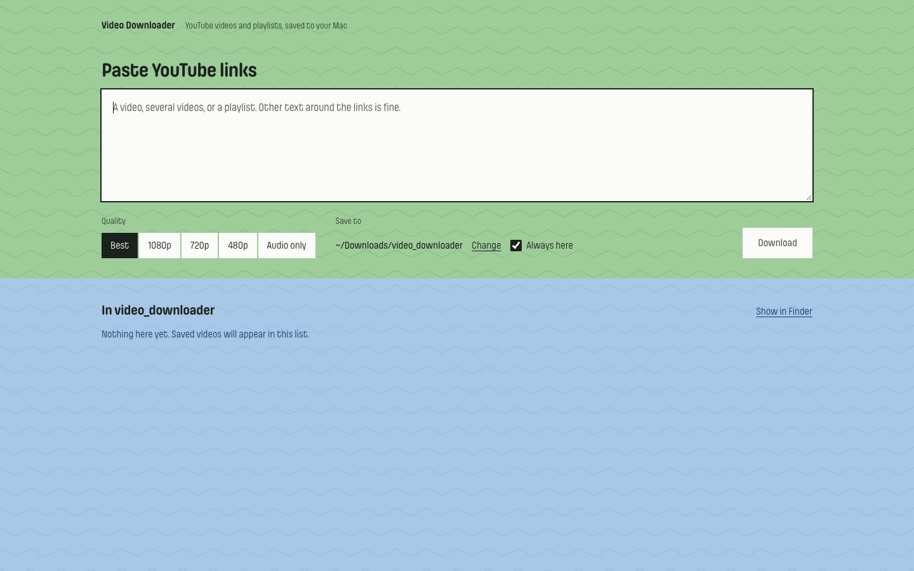

# Video Downloader

A small Mac app for saving YouTube videos and playlists to a folder on your computer.
Paste links, pick a quality, press Download.

The goals are simple: one screen that does one job, downloads that finish, and full speed
every time. It's a thin, readable layer over [yt-dlp](https://github.com/yt-dlp/yt-dlp),
the widely used open-source downloader, and it keeps yt-dlp up to date on its own so it
keeps working when YouTube changes.



## What it does

- Paste any text that contains YouTube links: one video, several, or a playlist. Links are
  found automatically, playlists expand into their videos, and duplicates are dropped.
- Choose Best, 1080p, 720p, 480p or Audio only (mp3).
- Pick a folder once, or tick **Always here** to skip the question next time.
- Videos download one at a time with live progress. The x on a row skips that video.
- **Cancel** stops everything and deletes every file that download created, so your folder is
  left exactly as it was. Existing files are never overwritten: a repeat saves as `… (1).mp4`.
- Quitting stops a running download and removes its partial file; finished files stay.

## Privacy and safety

No accounts, no tracking, no analytics, no ads. Everything runs on your Mac. The app talks to:

| Where | Why |
| --- | --- |
| YouTube (`youtube.com`, `googlevideo.com`, `ytimg.com`) | The videos you ask for, and their thumbnails |
| PyPI (`pypi.org`, `files.pythonhosted.org`) | Checking for a newer yt-dlp at launch and every 6 hours, and fetching ffmpeg once on first launch |
| Fontshare (`api.fontshare.com`, `cdn.fontshare.com`) | The typeface the window uses |

Nothing about you or your downloads is sent anywhere else. Files stay on your computer:

- your videos, in the folder you choose;
- your two settings (last folder, "Always here"), in `~/.video_downloader.json`;
- ffmpeg and downloaded yt-dlp updates, in `~/Library/Application Support/Video Downloader/`.

**How updates are checked.** A newer yt-dlp is downloaded from PyPI and checked against the
SHA-256 checksum PyPI publishes for it. It is then loaded once in a separate process as a test,
and only used if that works. If anything fails (for example, you're offline), the app keeps the
version it has. The current version shows in the top right of the window. See
[`engine.py`](engine.py).

The whole app is about 1,600 lines of Python, HTML and shell in this repository, so you can
read exactly what it does.

## Install

Requires an Apple Silicon Mac (M1 or newer) with macOS 12 or later.

1. Download **Video-Downloader-mac.zip** from the
   [latest release](https://github.com/AnuBis7Star/video-downloader/releases/latest) and open it.
   The release notes list its SHA-256, so you can check the download with
   `shasum -a 256 Video-Downloader-mac.zip`.
2. Drag **Video Downloader** into Applications.
3. The app isn't signed with a paid Apple developer certificate, so the first time you open it
   macOS says it can't verify it. Allow it once under **System Settings → Privacy & Security →
   Open Anyway**; after that it opens normally.

On first launch it fetches ffmpeg (about 22 MB) from PyPI, once. ffmpeg's build is
GPL-licensed, so it isn't shipped inside the app; it comes from the
[imageio-ffmpeg](https://github.com/imageio/imageio-ffmpeg) package, pinned to the version
the app was built with and checked against PyPI's SHA-256.

If you'd rather not trust a prebuilt app, build it yourself from this source, as below.
It's the same thing.

## Build it yourself

You need [uv](https://docs.astral.sh/uv/) (`brew install uv`).

```bash
git clone https://github.com/AnuBis7Star/video-downloader.git
cd video-downloader
./build_app.sh --install
```

This puts **Video Downloader** in `~/Applications`, with a shortcut in `/Applications`. The
app carries Python, yt-dlp and [Deno](https://deno.com) (the official release, checked
against its published checksum), which yt-dlp uses to answer YouTube's playback challenge so
downloads aren't slowed down. ffmpeg arrives on first launch, as above. The license texts of
everything inside are in `Video Downloader.app/Contents/Resources/licenses`, gathered by
[`collect_licenses.py`](collect_licenses.py).

`./build_app.sh --zip` also makes `dist/Video-Downloader-mac.zip`, with
[`How to open.txt`](share/How%20to%20open.txt) and the license, for giving the app to someone.

### Other ways to run it

```bash
uv run desktop.py    # the app window, straight from the source
uv run app.py        # the same page in your browser at http://127.0.0.1:5050
uv run downloader.py URL [URL ...] [-q best|1080|720|480|audio] [-o DIR]   # command line
```

Running from source needs Deno on your PATH (`brew install deno`).

## How it works

| File | Role |
| --- | --- |
| [`downloader.py`](downloader.py) | Calls yt-dlp: looks up videos and playlists, downloads one video, reports progress |
| [`app.py`](app.py) | A small local web server: the queue, skip, cancel, the folder list |
| [`templates/index.html`](templates/index.html) | The one screen |
| [`engine.py`](engine.py) | Keeps yt-dlp up to date |
| [`desktop.py`](desktop.py) | Shows the page in a native Mac window |
| [`build_app.sh`](build_app.sh) | Packages everything into a standalone `.app` |
| [`collect_licenses.py`](collect_licenses.py) | Gathers the license texts of everything the app contains |

Each video downloads in its own process inside a private temporary folder, so skip and cancel
can stop it (with its ffmpeg) at once and delete every partial file. Finished videos are moved
into your folder. Link lookups also run in fresh processes, which is how a yt-dlp update takes
effect without restarting the app.

## Please download responsibly

Only download videos you have the right to keep: your own, ones whose creators allow it, or
ones that are free to reuse. YouTube's Terms of Service restrict downloading, and copyright
applies to most videos.

## License

[MIT](LICENSE). yt-dlp, Deno, Python and the other components inside the app keep their own
licenses (MIT, BSD, Apache, PSF, Unlicense and similar); ffmpeg, fetched separately, is GPL.
